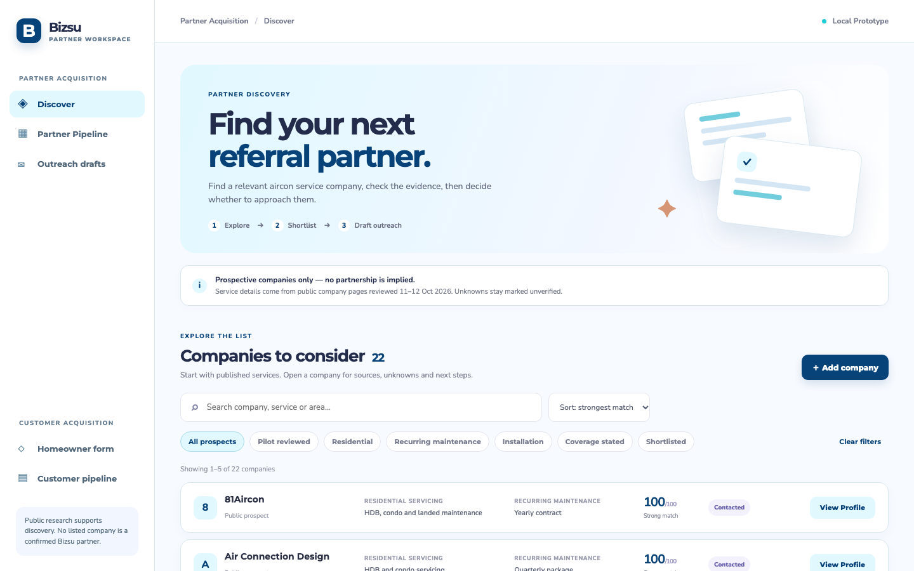
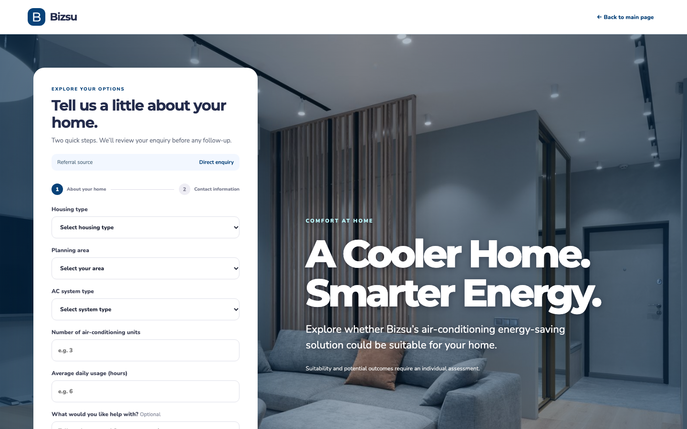
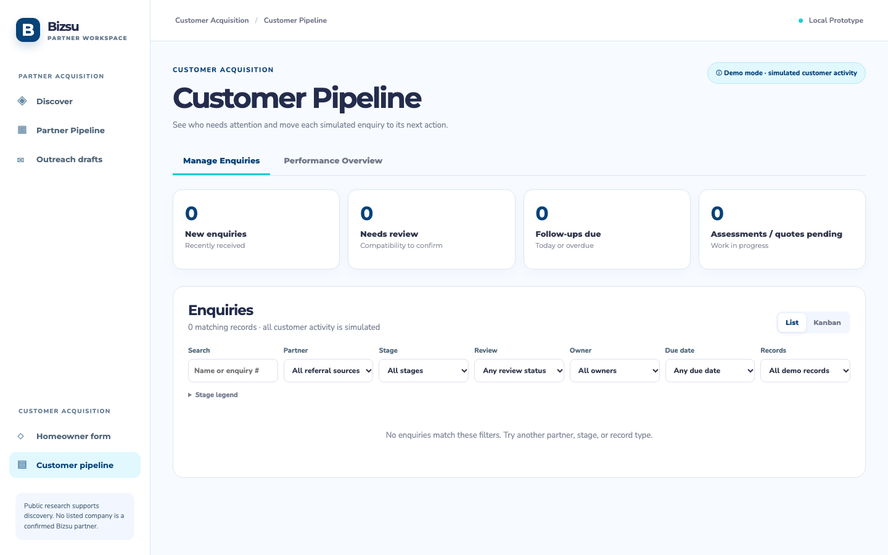

# Bizsu Partner and Customer Pipeline

A prototype for researching Singapore air-conditioning servicing partners, preparing reviewable outreach, and following attributed homeowner enquiries. Company profiles come from public research. Referral partners, visits, enquiry outcomes, and any walkthrough figures are simulated; no listed company has agreed to partner with Bizsu.

The prototype does not send email or book appointments. Staff review and send drafts outside the app.

## Screenshots

Captured from the local prototype on 16 October 2026. The customer pipeline is empty after the sample-enquiry reset; the company list is research for prospective partners, not a list of confirmed Bizsu partners.

### Partner discovery



**Annotations:** The left navigation separates partner and customer work. The company list supports searching, filtering, and opening a profile to review sources before preparing outreach.

### Homeowner enquiry form



**Annotations:** The form begins with home and AC details, then asks for contact information in step two. The referral source shows whether a visitor came directly or through a partner link.

### Customer pipeline



**Annotations:** Summary cards highlight new enquiries, reviews, due follow-ups, and assessments or quotes. Search and filters help staff find records as enquiries arrive; this screenshot shows the clean starting state.

## Watch the walkthrough

[Watch the 2:56 Bizsu pitch walkthrough](public/videos/bizsu-client-pitch.mp4). It was recorded on 15 October 2026 with illustrative enquiries and an earlier interface. The current app starts with an empty customer pipeline.

## Run locally

Use Node.js 22+ and Python 3.13. Install dependencies:

```bash
python3.13 -m venv .venv
.venv/bin/python -m pip install -r requirements.txt
npm ci
```

Start FastAPI and Vite in separate terminals:

```bash
.venv/bin/python -m uvicorn backend.main:app --host 127.0.0.1 --port 8000
npm run dev -- --port 5173
```

Open <http://127.0.0.1:5173/>. The API creates an ignored `data/demo.db` on first run. It seeds fictional referral sources and a research snapshot of potential partner companies, **but no sample enquiries**. Submit fictional contact details through `/demo/form` to try the customer pipeline. Saved drafts remain manual; nothing is sent.

The local database is not committed. To reset an existing local demo, back it up and clear `leads`, `stage_events`, `lead_activity`, `followup_drafts`, and `referral_events`. The current local copy was reset before this release. The `seed_enquiries=True` option exists only for explicit test and presentation fixtures.

## Deploy to Vercel with Supabase

The frontend is a Vite app; `api/index.py` exposes FastAPI as a Vercel Python Function. The catch-all rewrite in `vercel.json` supports direct links to the SPA routes. The deployment build enables the staff workspace and shows a staff-key prompt before it loads.

1. Create a Supabase project in an appropriate region. Copy its **Transaction pooler** connection URI from **Connect**. Use the URI as the Vercel `DATABASE_URL` environment variable. The server connects over TLS; never use a browser-visible `VITE_` variable for this credential.
2. Generate a long random value and set it as `BIZSU_ADMIN_KEY` in Vercel. Share it only with staff who may view enquiry contact details. The key is checked by the API and kept in browser session storage for the current tab. Leave `BIZSU_PUBLIC_FORM` unset or `0` for a staff-only demo.
3. Import this repository into Vercel with the root directory set to the repository root. The committed `vercel.json` builds the frontend and routes `/api/*` to FastAPI. Pin Python 3.13 using `.python-version`.
4. Deploy a preview first. Check `/api/health`, unlock the workspace, verify the empty enquiry list, submit a fictional enquiry, refresh, and confirm that it remains. Review access before promoting to production.

The first API startup creates the required tables in Supabase Postgres and seeds only fictional referral sources and sourced company profiles. All mutable workspace records, including enquiries, drafts and stage history, use the same Supabase database when `DATABASE_URL` is set. Vercel's temporary filesystem is never used for customer records.

For a public homeowner form, set **both** `BIZSU_PUBLIC_FORM=1` and `VITE_PUBLIC_FORM=true` in Vercel and redeploy. Do this only after Bizsu has reviewed its privacy notice, consent text, retention policy, and anti-abuse controls for real enquiries. The public form does not grant access to saved enquiries; staff access still requires the key.

The current project has no Supabase credentials in Git. Do not commit `.env` files or connection strings.

## Checks

```bash
.venv/bin/python -m pytest -q
npm test
npm run build
```

The source data, dates, and caveats are recorded in [data/sources.json](data/sources.json), [data/company_candidates.json](data/company_candidates.json), and [PROJECT-KNOWLEDGE.md](PROJECT-KNOWLEDGE.md). The conversion model is trained only on synthetic examples and is not a validated sales prediction.
